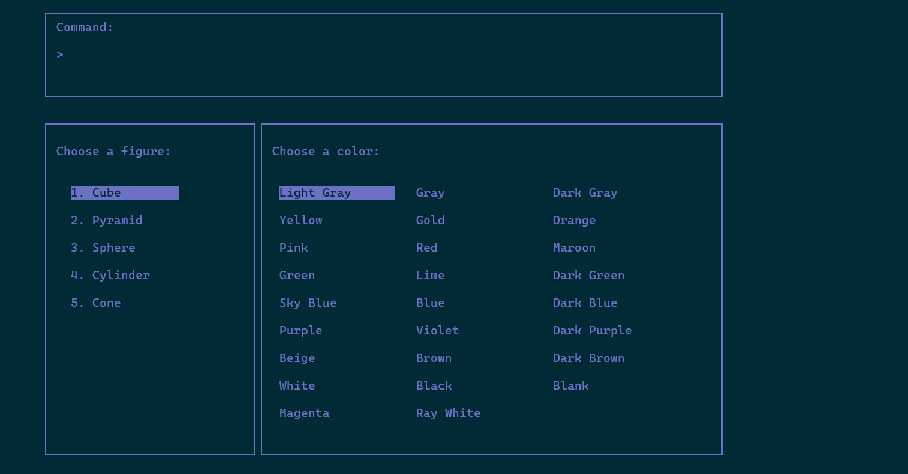
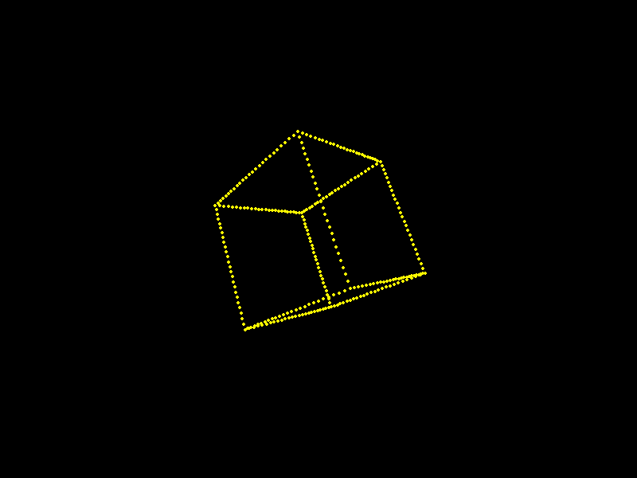
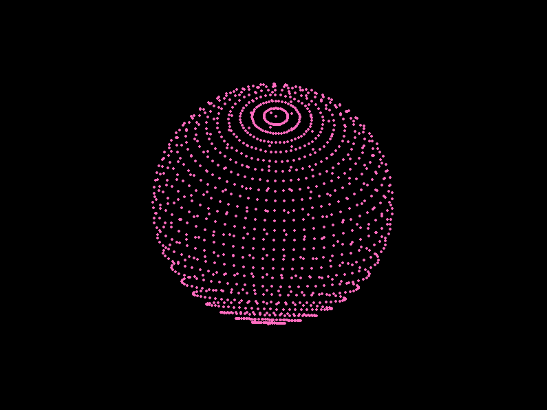
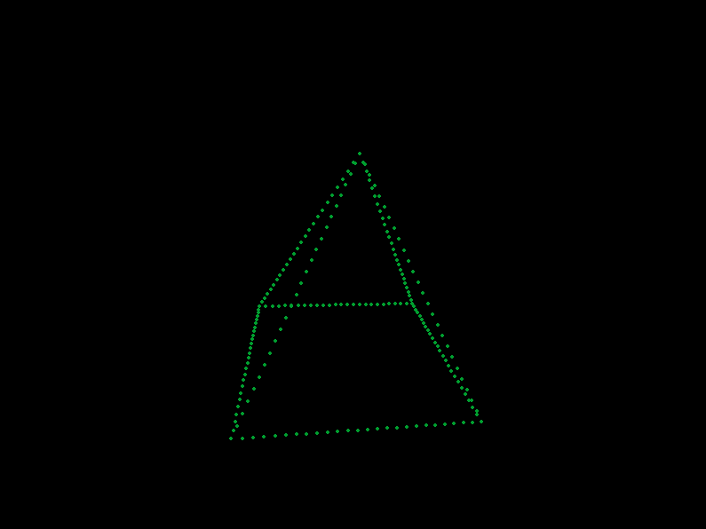
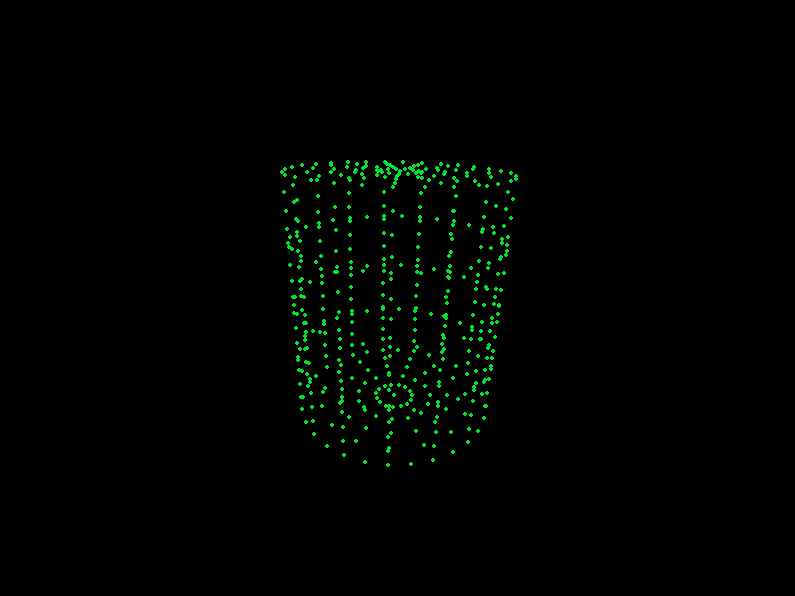
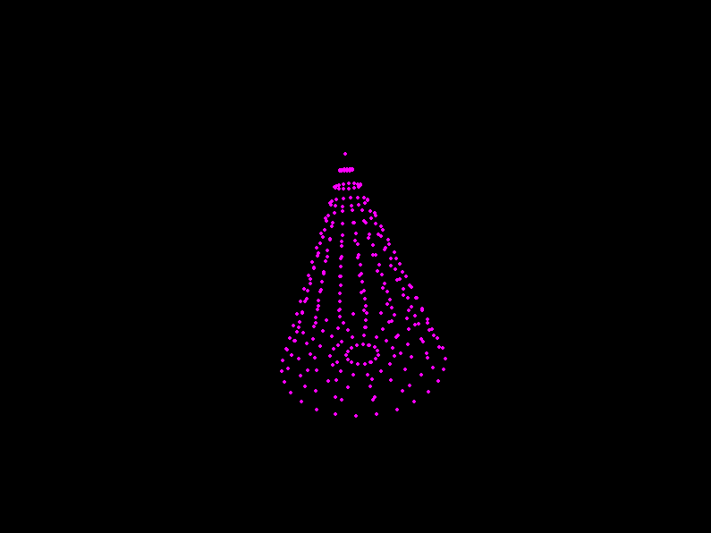

# 3D Shape Viewer

Terminal 3D shape viewer in C++17 (raylib + ncurses). Pick a shape and a color, and it renders in the terminal. Geometry, rotations and perspective projection are written by hand.

Shapes: cube, pyramid, sphere, cylinder, cone.

## Demo



| Cube | Sphere | Pyramid | Cylinder | Cone |
|:----:|:------:|:-------:|:--------:|:----:|
|  |  |  |  |  |

## Build

Needs a C++17 compiler, CMake, raylib and ncurses.

```
cmake -S . -B build
cmake --build build
./build/renderer
```

## Usage

- Enter a command or press `Enter` to go to shape selection.
- `W` / `S` to choose a shape, `Enter` to confirm.
- `W` / `A` / `S` / `D` to choose a color, `Enter` to confirm.

The terminal window must be large enough.

## Tests

```
cmake -S . -B build -DBUILD_TESTING=ON
cmake --build build
ctest --test-dir build --output-on-failure
```